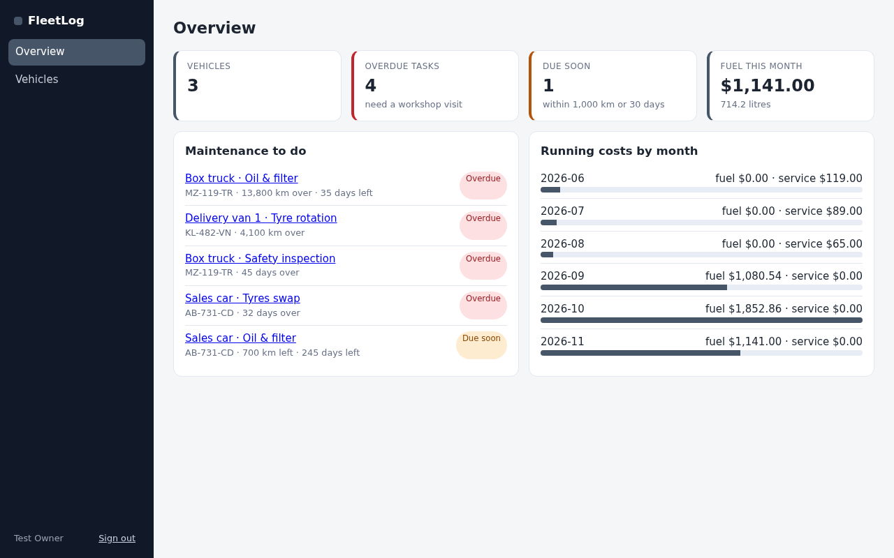
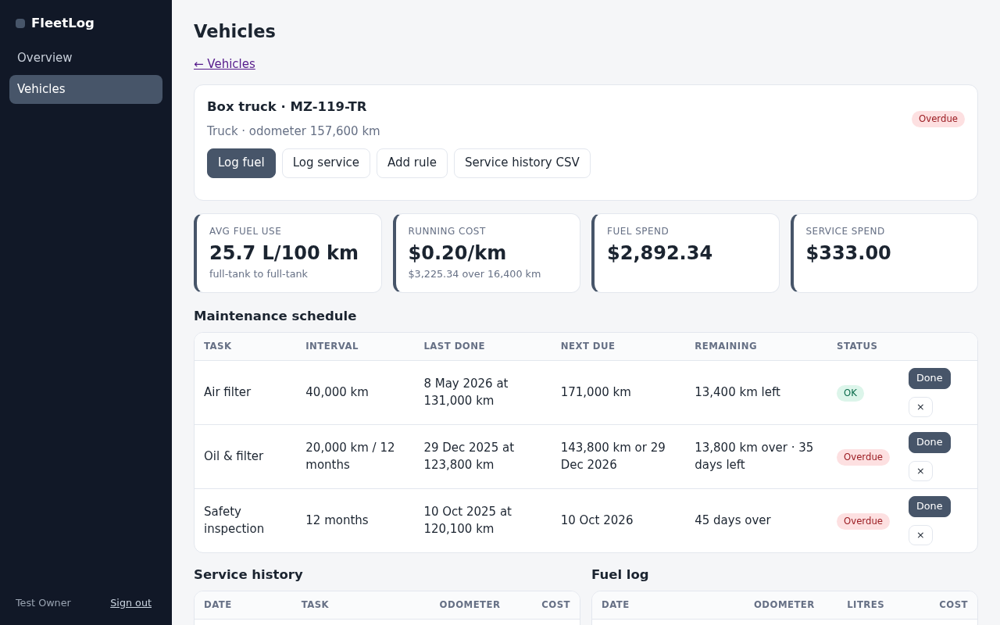
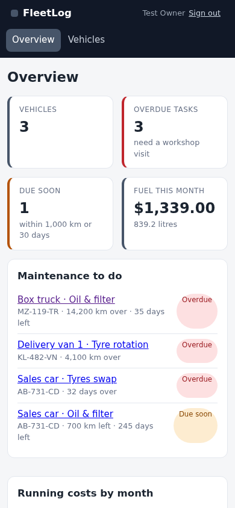

# FleetLog

Vehicle maintenance tracker: rules by km or months, odometer consistency, fuel efficiency and running costs.

_Screenshots of the running app with fictional demo data (captured from the real app in Chrome)._

**Status: local demo, fictional data, not security-reviewed.**

## Features
- Maintenance rules (km or months)
- Odometer sanity checks
- Full-tank fuel efficiency
- Running cost per km, CSV export

## Run
Requires Node 22+ (no npm install needed).

    node server.js        # http://127.0.0.1:3000 (PORT overrides; HOST is loopback unless you set it)
    npm test              # unit and API tests
    npm run e2e           # browser test, needs google-chrome
    node docs/overflow-check.js   # phone layout: no sideways page scroll at 390 and 320 px

First run: open the page and create the owner account (username, name, password of 10+ characters). There is no built-in or default account. Setup works once per database; after that it is a normal sign-in.

## Honest limits
- Fictional seed data, local use only.
- Not security-reviewed. No HTTPS, no password reset, a single owner role. Do not expose it to a network without a reverse proxy with HTTPS and your own review.
- Tests and browser checks create a throwaway owner with a random in-memory password; nothing credential-like is stored in the repo.
- Service intervals are examples you can edit. They are not manufacturer or regulatory inspection schedules.
- No telematics or reminders sent.
- Data lives in a local sqlite file; back it up yourself.
